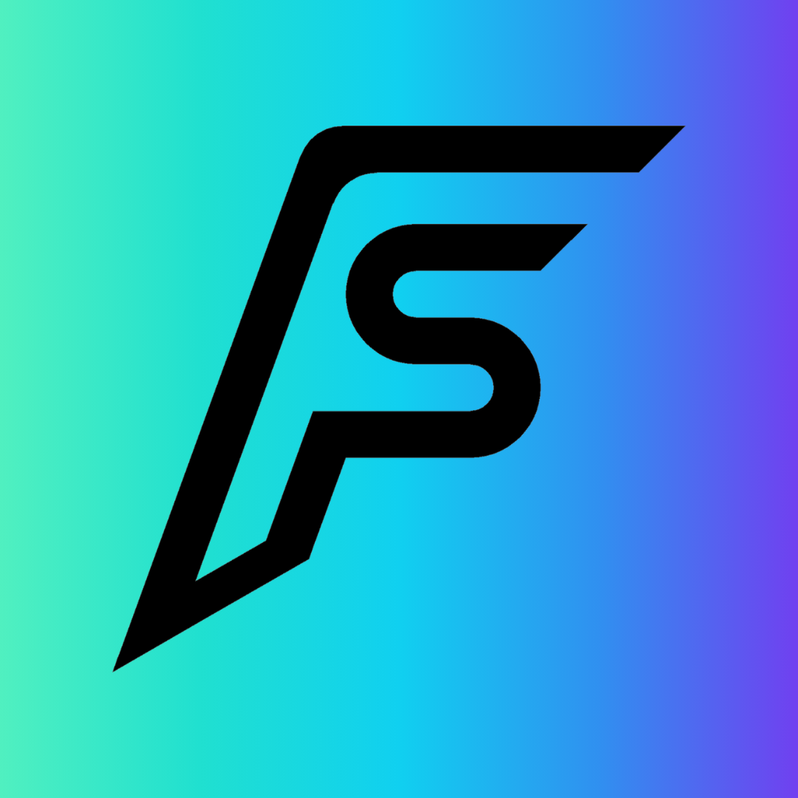

# Brand

Visual identity for **FlixShift**.

## Logo



An F with an S inside it, slanted for motion: the "shift". Black on the brand
gradient, square. Used as the app icon (iOS rounds the corners), the website
icons and the Instagram profile picture.

- **File:** `docs/brand/logo.png` (1080 × 1080). Ask for a vector version
  (SVG or PDF) and the mark alone on a transparent background, in black and
  in white, before using it anywhere else.
- **Don't** redraw, recolor, stretch or add effects to the mark.
- **At 16 px** (browser tabs) the inside of the S fills in; it still reads as
  an F. A simplified small-size version would fix that if it matters.

## Colors

| Name | Hex | Use |
| --- | --- | --- |
| Mint | `#50F0C0` | Start of gradient, highlights |
| Teal | `#20E0D0` | Primary accent |
| Cyan | `#10D0F0` | Bright middle of gradient |
| Blue | `#3090F0` | Gradient transition |
| Violet | `#7040F0` | End of gradient |
| Purple | `#9050F0` | Secondary accent |
| Deep Navy | `#050B18` | Background; text on the gradient |
| Navy | `#101B30` | Cards and list rows on Deep Navy |
| Off White | `#F5F7FA` | Primary text |

## Gradient

Mint → Teal → Cyan → Blue → Violet, running top-left to bottom-right:

```text
#50F0C0 → #20E0D0 → #10D0F0 → #3090F0 → #7040F0
```

Use it sparingly so it stays special: hero elements (the savings card, the
app icon, the logo), not every surface.

## Guidelines

- **Dark backgrounds.** The palette is built for Deep Navy with Off White
  text.
- **Teal for interactive elements**: buttons, toggles, links.
- **Keep Violet and Purple off small text.** They're low-contrast on Deep
  Navy; use them in fills and gradients.
- **The codename stays internal.** Concept art may show "Project Shift-eze",
  but no user-facing logo, app name or store asset uses it.
